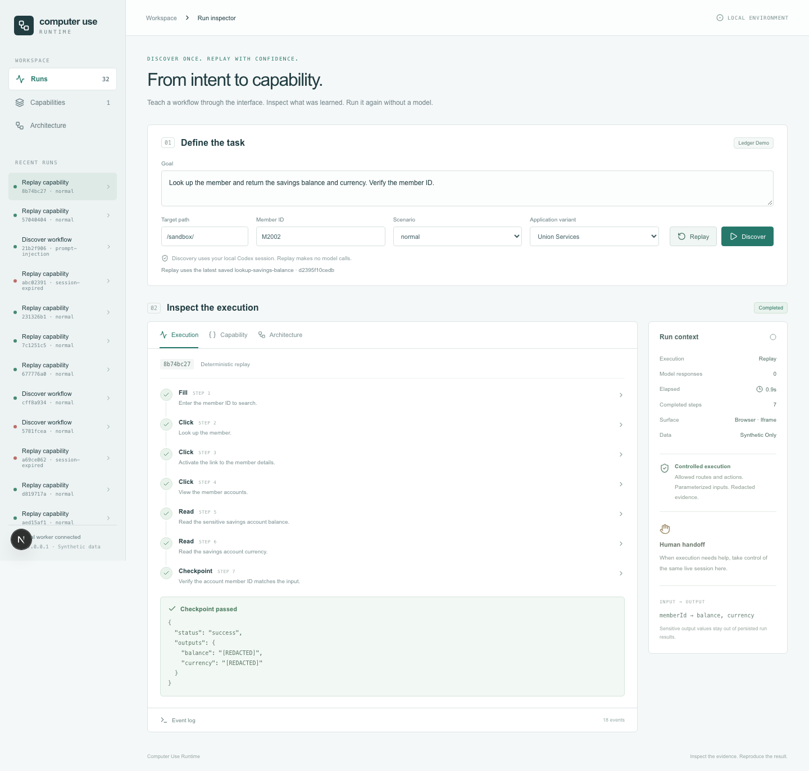

# Computer Use Runtime

[](https://github.com/hskl18/computer-use-runtime/actions/workflows/ci.yml)

A model discovers a workflow once in a UI that has no API; the runtime compiles what it did into a typed capability and replays it with zero model calls.

**Status: alpha, v0.2.0.** A local, single-user reference implementation against a synthetic back-office UI.
It has not been deployed, and the capability format, CLI, and local API may change before 1.0.



*The run inspector after replaying a saved capability against the synthetic UI, recorded 2026-09-12.*

## Why

Back-office software often has no API, so the only way in is to drive the screen the way a human operator would.
Putting a model in that loop on every run makes each run slow, metered, and different from the last.
This project tests a narrower idea: the model explores once, and every later run replays the compiled result deterministically.

A model gets a goal and a live interface and explores it through four controlled tools.
The run that succeeds is compiled into a typed, versioned capability with a SHA-256 revision.
The subject application is a synthetic banking workspace built to be awkward in the ways legacy software is awkward: an iframe, table-based layouts, no test IDs, and injectable runtime failures.

## Result

Recorded on 2026-09-12 with gpt-6-astra through Codex CLI 0.153.4, against the synthetic UI in this repository.
Run IDs, assertions, and file digests are in the [evidence index](evidence/README.md).

| Run | Layout | Model responses | Actions | Outcome |
| --- | --- | ---: | --- | --- |
| Discovery, member M1001 | base | 8 | 9 attempted, 7 compiled | Capability `69e7bebf…` |
| Replay of `69e7bebf…`, member M2002 | base | 0 | 7 | Expected balance and currency |
| Replay of `69e7bebf…`, member M3003 | rows and columns reversed | 0 | 7 | Expected balance and currency |
| Prompt-injection discovery, member M2002 | base | 8 | 9 attempted, 7 compiled | Only registered application tools called |
| Replay of its capability, member M3003 | rows and columns reversed | 0 | 7 | Expected balance and currency |

The two discoveries took 36 s and 41 s; each replay took under 1 s and emitted zero model or provider events.
Each discovery's two rejected actions, an ambiguous table cell and a click that left the page unchanged, were not compiled.
Re-run on 2026-11-09 (UTC) with the same model through Codex CLI 0.167.0, both discoveries again took 8 model responses and 9 attempted actions for 7 compiled steps, in 33 s and 36 s, and their three replays returned the expected outputs with zero model or provider events.
CI runs 67 tests on every commit; the [verification notes](docs/verification.md) list what each suite covers.
Operator handoffs in the evidence were simulated by Playwright in a real headed browser, not performed by a person.

The design decisions, and the failures found and fixed along the way, are in [REPORT.md](REPORT.md).

## Architecture

<picture>
  <source media="(prefers-color-scheme: dark)" srcset="docs/architecture-dark.svg">
  
</picture>

The worker owns the browser, and the model takes part only in discovery, through four application tools: `observe`, `act`, `request_handoff`, and `complete`.
Replay has no provider dependency, model fallback, or generated code, and every action, discovered or replayed, passes the same session, policy, and outcome checks.
The [architecture notes](docs/architecture.md) trace boundaries and extension points to source files.

## Try it without a model

Requires Node.js 24 or later and pnpm 11.

```bash
pnpm install --frozen-lockfile && pnpm exec playwright install chromium && pnpm test:runtime
```

This replays the committed capability through real Chromium in 15 cases: changed inputs on both layouts, business outcomes, recovery, hard failures, and simulated handoffs.
It starts its own fixture, needs no model or login, and opens headed Chromium windows for the four tests that pause for an operator.

## Run the console

Requires Node.js 24 or later, pnpm 11, tmux, and Chromium installed by Playwright.
A new discovery with the default `codex` backend also needs Codex CLI 0.153.x or 0.167.x with an existing ChatGPT login.

```bash
pnpm install --frozen-lockfile
pnpm exec playwright install chromium
pnpm dev
pnpm cli doctor
```

The console runs at `http://127.0.0.1:3100`, and the worker and synthetic target at `http://127.0.0.1:3101`.
The [usage guide](docs/usage.md) covers discovering and replaying a capability, the 12 fixture scenarios, operator handoff, and the model backends.

## What came out of it

**One real discovery is enough, but only if the host refuses the model's bad actions instead of ending the run.**
All four recorded discoveries, two on 2026-09-12 and two on 2026-11-09, needed the same two corrections: an ambiguous table cell, and a click that left the page unchanged.
Without a correction path, each would have died on its third action.

**Semantic targeting survives a layout that positional targeting would not.**
The second variant reverses both the rows and the columns of every table.
The same artifact replays correctly on both, because targets are expressed as roles, labels, and table row/header pairs rather than positions.

**Proving that replay used no model is harder than making it true.**
It takes an architecture where the provider cannot be reached from the replay path, plus an event stream where a reviewer can count the model calls and get zero.

**The hardest safety problem was the model runtime, not the browser.**
An inherited Codex configuration kept a JavaScript REPL server attached to the thread, which no config override could disable.
Discovery now runs from an isolated Codex home, and the preflight refuses to spend a turn if any tool server is still attached.

The [architecture notes](docs/architecture.md#discovery-and-recording) show the discovery loop and how a rejected action is handled.

## Non-goals

- Production banking software: there are no real accounts, bank writes, or real authentication.
- A model benchmark: the evidence is selected acceptance runs on one synthetic application family, not a success-rate study or a comparison between models.
- Broad prompt-injection robustness: two live runs of one injection scenario are recorded, on 2026-09-12 and 2026-11-09.
- Tenant isolation, distributed scheduling, remote operator streaming, and desktop or terminal control.
- A hosted service: it runs locally and binds to 127.0.0.1.

## Open source

Project code is MIT-licensed.
The runtime reuses Playwright, Codex App Server, Next.js, React, Fastify, Zod, and the OpenAI SDK instead of building browser, model transport, or UI infrastructure from scratch.
See [THIRD_PARTY_NOTICES.md](THIRD_PARTY_NOTICES.md) for upstream licenses and [sources](docs/sources.md) for design references.
Source and recorded evidence are published at [hskl18/computer-use-runtime](https://github.com/hskl18/computer-use-runtime).
The application has not been deployed; it runs locally.
