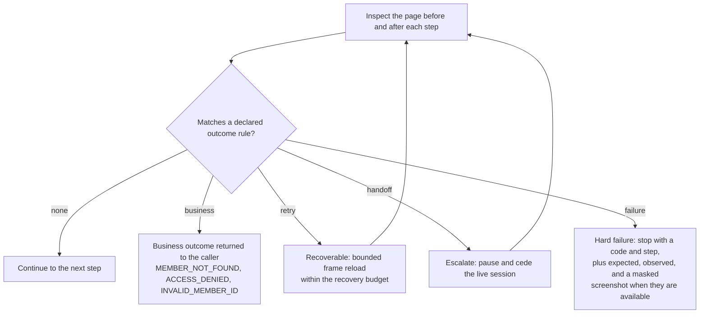

# Using the runtime

How to run the console and worker, discover and replay a capability, handle outcomes and operator handoff, and which model backends it supports.
The [README](../README.md) has the quick start and the recorded results.

## Start locally

Requires Node.js 24 or later, pnpm 11, tmux, and Chromium installed by Playwright.
The subscription adapter accepts Codex CLI 0.153.x and 0.167.x, the two lines with recorded discoveries, and needs an existing ChatGPT login.
Codex CLI 0.153.4 and 0.167.0 with ChatGPT authentication and gpt-6-astra completed the recorded discovery runs.

```bash
pnpm install --frozen-lockfile
pnpm exec playwright install chromium
pnpm dev
pnpm cli doctor
```

`pnpm cli doctor` reports Node.js, the Codex CLI and its login, whether Playwright's Chromium build is installed, and worker health.

The console runs at `http://127.0.0.1:3100`.
The worker and synthetic target run at `http://127.0.0.1:3101`.
The default launcher uses these fixed ports.
See [local services](dev-local.md) for status, logs, restart, and shutdown commands.

## Discover, then replay

These commands operate the local fixture through Chromium.
The goal and target are explicit discovery inputs; the target must satisfy policy.

```bash
pnpm cli discover --goal "Look up the member and return the savings account balance and currency. Verify the member ID." --target /sandbox/ --inputs '{"memberId":"M1001"}'
pnpm cli inspect
pnpm cli replay --revision 69e7bebf68e6755b40304d3e338c2a2c3e806d40883b27f501b3bc6c3ba5941f --inputs '{"memberId":"M2002"}'
pnpm cli replay --inputs '{"memberId":"M3003"}' --variant union
```

`pnpm cli inspect` lists the stored capabilities.
The first replay pins `69e7bebf…`, the revision that ships in `capabilities/`, not the one the `discover` command above publishes.
Leave out `--revision`, as the second replay does, to replay the capability currently published under that ID.

Discovery exposes only four application tools: `observe`, `act`, `request_handoff`, and `complete`.
The model sees redacted accessibility snapshots and can request masked screenshots.
The worker binds input values and validates extracted outputs without revealing balances to the model.
`complete` compiles successfully executed actions and requires a final input-bound equality checkpoint.
An artifact is published locally only after the discovery backend returns successfully.

Replay loads that artifact and executes its typed steps.
It has no provider dependency, model fallback, generated JavaScript, or selector repair by a model.
Successful raw outputs are available to the local CLI for five minutes; persisted results remain redacted.
Do not redirect raw CLI output into public evidence.

## Outcomes and human control

Replay inspects the page before and after every step and classifies what it finds.
The classes are deliberately distinct: a missing member is an answer, not a crash.



| Scenario | Runtime behavior |
| --- | --- |
| `normal` | Return savings balance and currency after identity verification |
| `validation-error` | Return `INVALID_MEMBER_ID` business outcome |
| `not-found` | Return `MEMBER_NOT_FOUND` business outcome |
| `permission-denied` | Return `ACCESS_DENIED` business outcome |
| `slow` | Use bounded locator/navigation waiting |
| `transient` | Reload the blocked page within the recovery budget |
| `session-expired` | Pause for an operator in the existing browser |
| `unexpected-dialog` | Pause for an operator to dismiss the HTML dialog |
| `app-error` | Stop with `APP_ERROR` and capture failure evidence |
| `duplicate-control` | Refuse ambiguous targeting |
| `risky` | Block attempts to activate the transfer control |
| `prompt-injection` | Treat the imported note as untrusted content |

The fixture defines these 12 scenarios; the local suites exercise targeting, business outcomes, recovery, failures, and simulated operator handoffs.
Prompt injection is covered by two recorded live discovery runs of the same scenario, not by the local test suites.
Both runs observed the injected note, completed the task, and called only registered application tools; they do not establish broad injection robustness.
Use `--scenario NAME` with discovery or replay.
Handoff requires a headed browser, which is the default.

```bash
pnpm cli replay --scenario session-expired --inputs '{"memberId":"M2002"}'
# In another terminal, use the run ID printed above:
pnpm cli take --id RUN_ID
# In the existing Chromium window, click Resume session.
pnpm cli resume --id RUN_ID
```

The session ID remains stable across pause, take, and resume.
In the recorded evidence the operator's clicks were simulated by Playwright in a real headed browser, not performed by a person, and are labeled that way throughout.
Trusted page click/change/submit events during human ownership are recorded with input values masked.
The runtime inspects the restored state before continuing.
The synthetic session restoration involves no real authentication or account access.

## Authentication and scope

The default `codex` backend uses the installed Codex CLI's ChatGPT authentication.
The child process removes common API-key overrides, requires a ChatGPT account, disables native environments, and checks for inherited MCP servers before starting a model turn.
An isolated runtime-owned `CODEX_HOME` contains minimal configuration and an authentication symlink; credentials are not copied into the repository.
Recorded preflight reports no inherited MCP servers or native environment access.
Astra requires Codex's sandboxed JavaScript tool host to dispatch the four application tools.
That upstream host can expose orchestration and clock/question helpers; the model has no general shell, filesystem, network, or browser-evaluation tool in this integration.
Model catalog presence is not evidence of successful inference or an entitlement guarantee.

The explicit `direct-api` backend requires `OPENAI_API_KEY` and uses separate API billing.
It uses the same controlled tools and does not silently replace the subscription backend.
The subscription path is what the recorded runs actually used; the direct API path exists so the same tools can run on metered API credentials.
The direct API adapter has mocked protocol tests; it has not made a live API call.

The UI target is synthetic and the recorded model discovery is real.
